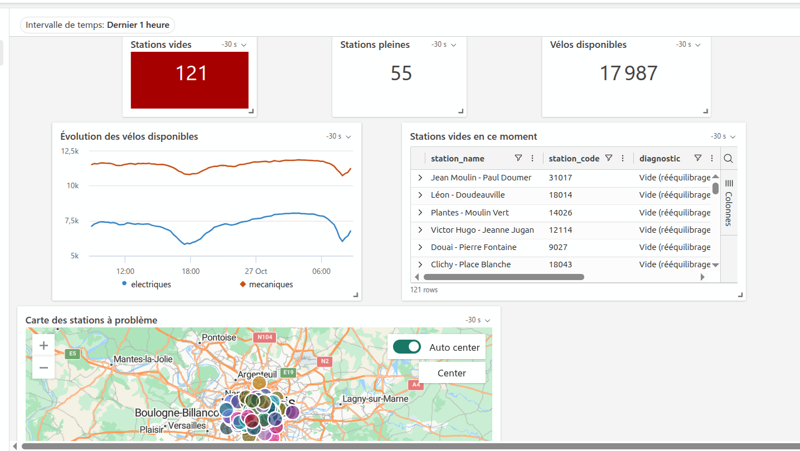
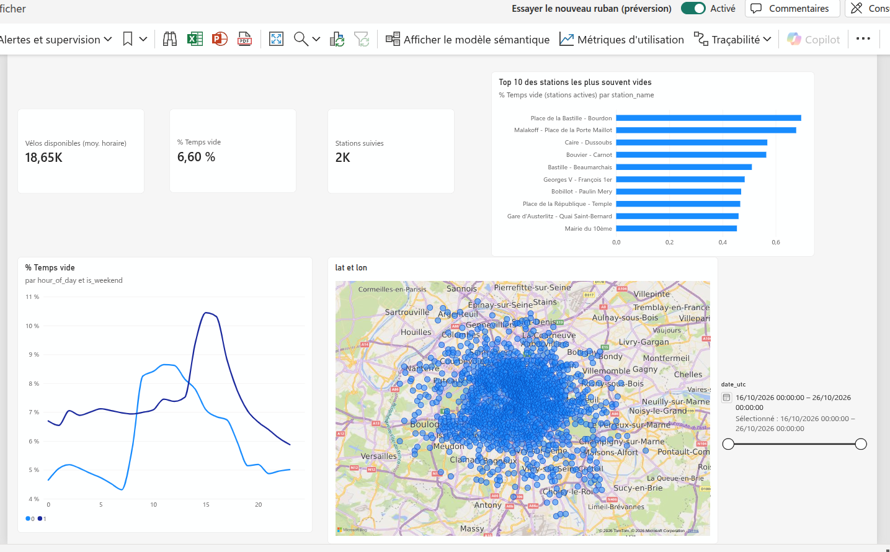
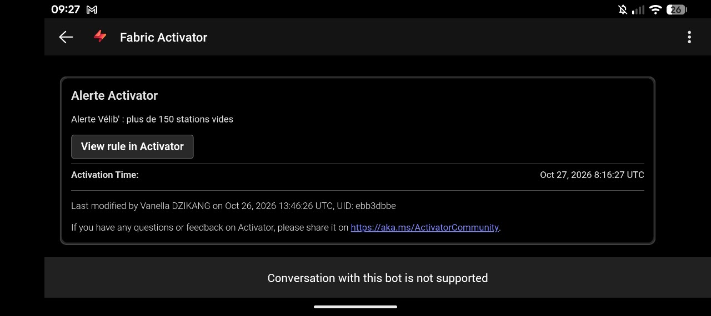
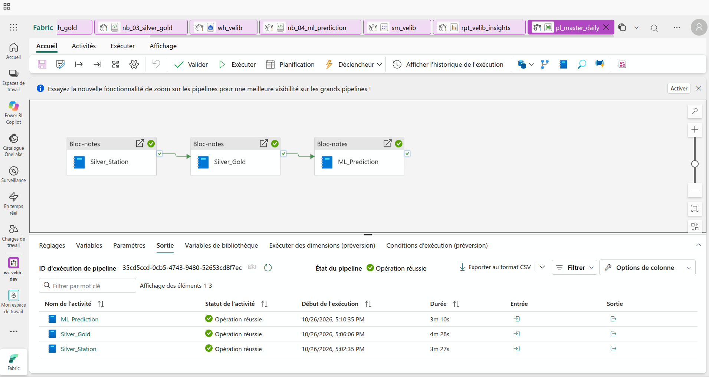
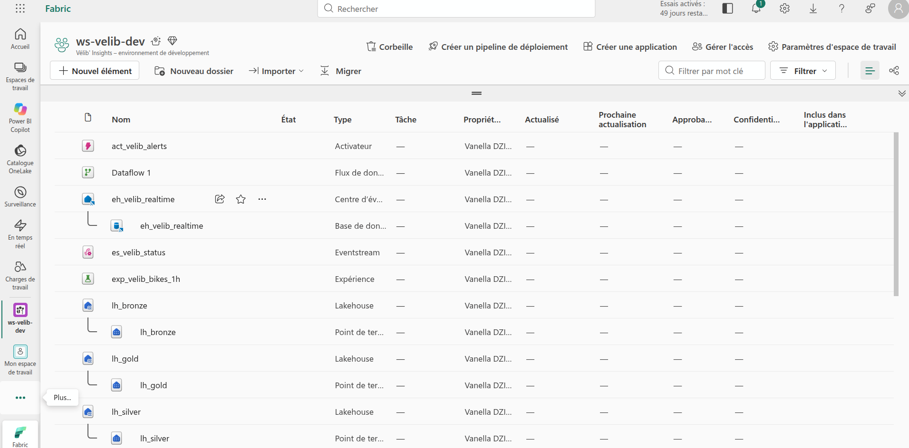
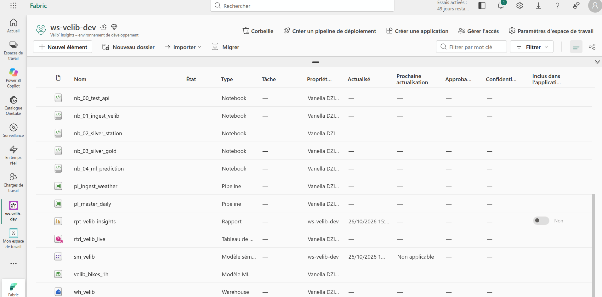
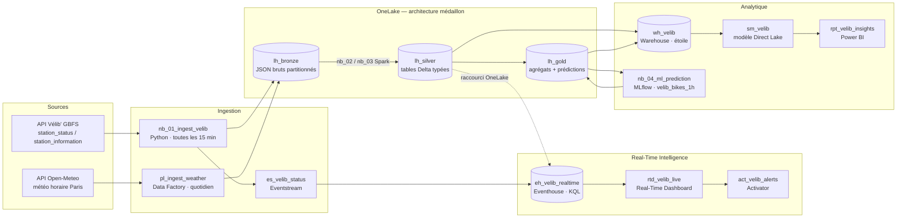

# Vélib' Insights - Plateforme data de bout en bout sur Microsoft Fabric

> **Où et quand les stations Vélib' se retrouvent-elles vides ou pleines, et peut-on le prévoir ?**
> Projet complet sur **Microsoft Fabric** : ingestion batch et temps réel, architecture médaillon,
> entrepôt SQL, Machine Learning, Power BI et alerting — construit sur **données réelles** (open data Vélib' Métropole + Open-Meteo).


---

## Captures

### Tableau de bord temps réel (`rtd_velib_live`)

Indicateurs en direct avec mise en forme conditionnelle, évolution des vélos électriques / mécaniques (on voit la pointe du matin vers 7-8 h), liste des stations vides avec diagnostic, carte des stations à problème.



### Rapport Power BI (`rpt_velib_insights`, Direct Lake)

Profil horaire semaine / week-end, Top 10 des stations actives les plus souvent vides, carte des stations, filtre par date.



### Alerte Activator reçue en conditions réelles

Déclenchée le 27/10/2026 pendant la pointe du matin (plus de 150 stations vides).



### Pipeline maître (`pl_master_daily`)

Silver → Gold → ML, enchaînés sur réussite, avec nouvelle tentative automatique — environ 11 minutes.



### Espace de travail Fabric (`ws-velib-dev`)

L'ensemble des éléments du projet : lakehouses, notebooks, pipelines, Eventstream, Eventhouse, Activator, Warehouse, modèle sémantique, rapport, expérience et modèle ML.

|                                                       |                                                       |
| ----------------------------------------------------- | ----------------------------------------------------- |
|  |  |

## Contexte métier

Vélib' compte environ **1 500 stations** à Paris et en petite couronne. Deux situations dégradent le service :
une station **vide** (impossible de prendre un vélo) ou **pleine** (impossible de le déposer).
Les équipes d'exploitation doivent savoir **où envoyer les camions de rééquilibrage, et quand**.

Ce projet construit la **« tour de contrôle »** de l'exploitant :

| Besoin                              | Réponse apportée                                                    |
| ----------------------------------- | ------------------------------------------------------------------- |
| Que se passe-t-il **maintenant** ?  | Tableau de bord temps réel + carte des stations à problème          |
| Être **prévenu** d'une dégradation  | Alerte automatique (Activator) au-delà de 150 stations vides        |
| Que s'est-il passé **avant** ?      | Historique propre (médaillon) + modèle en étoile + rapport Power BI |
| Que va-t-il se passer **bientôt** ? | Modèle de prédiction à 1 h, suivi dans MLflow                       |

---

## Architecture



**Orchestration** : `pl_master_daily` enchaîne chaque jour `nb_02 → nb_03 → nb_04`.

---

## Composants Microsoft Fabric utilisés

| Charge de travail          | Éléments                                                                        | Rôle                                                                               |
| -------------------------- | ------------------------------------------------------------------------------- | ---------------------------------------------------------------------------------- |
| **Data Factory**           | `pl_ingest_weather`, `pl_master_daily`                                          | Copie HTTP → Lakehouse (paramètres, contenu dynamique), orchestration planifiée    |
| **Data Engineering**       | `lh_bronze`, `lh_silver`, `lh_gold`, notebooks `nb_01` à `nb_03`                | Ingestion Python, transformations PySpark, tables Delta, médaillon                 |
| **Real-Time Intelligence** | `es_velib_status`, `eh_velib_realtime`, `rtd_velib_live`, `act_velib_alerts`    | Streaming (point de terminaison personnalisé), KQL, tableau de bord live, alerting |
| **Data Warehouse**         | `wh_velib`                                                                      | Modèle en étoile en T-SQL (CTAS, vues), requêtes inter-bases                       |
| **Data Science**           | `nb_04_ml_prediction`, expérience `exp_velib_bikes_1h`, modèle `velib_bikes_1h` | Entraînement scikit-learn, suivi et registre MLflow, scoring batch                 |
| **Power BI**               | `sm_velib`, `rpt_velib_insights`                                                | Modèle sémantique Direct Lake, mesures DAX, rapport                                |
| **OneLake**                | Raccourci `silver_station` dans l'Eventhouse                                    | Une seule copie de la donnée, utilisée par le lakehouse et la base KQL             |

---

## Contenu du dépôt

```
velib-insights-fabric/
├── notebooks/
│   ├── nb_01_ingest_velib.py        # Collecte API (Bronze) + envoi Eventstream (SAS / REST)
│   ├── nb_02_silver_station.py      # Référentiel des stations : Bronze → Silver (PySpark)
│   ├── nb_03_silver_gold.py         # Historique + météo (Silver) → agrégats horaires (Gold)
│   └── nb_04_ml_prediction.py       # Modèle de prédiction à 1 h, MLflow, scoring
├── kql/velib_realtime.kql           # Fonction de nettoyage, requêtes du dashboard, contrôles
├── sql/warehouse_star_schema.sql    # Schéma en étoile, vue KPI, requêtes métier
├── powerbi/measures.dax             # Mesures DAX du modèle sémantique
├── pipelines/                       # Configuration des pipelines Data Factory
└── docs/images/                     # Captures d'écran
```

---

## Résultats clés (16 → 26 octobre 2026)

### Fiabilité du pipeline

- **96 relevés par jour, chaque jour complet, sans aucune interruption** pendant 10 jours (week-end et passage à l'heure d'hiver inclus, grâce au stockage en UTC).
- **1 459 503 relevés** station × 15 min en Silver, **364 496 lignes** station × heure en Gold, **312 heures** de météo, **1 519 stations**.

### Ce que montrent les données

- En moyenne, **6,6 % du temps** une station active est vide ; environ **18 650 vélos** sont disponibles à une heure donnée.
- **Deux rythmes différents** : en semaine, la part de stations vides bondit **à partir de 7-8 h** (départs vers les bureaux) ; le week-end, le pic arrive **vers 14 h** (sorties de loisirs).
- Stations actives les plus souvent vides : **Place de la Bastille - Bourdon**, **Malakoff - Place de la Porte Maillot**, **Caire - Dussoubs**, **Bouvier - Carnot**, **Bastille - Beaumarchais**.
- Observé en direct : de **~63 stations vides** un vendredi soir à **~138** un lundi midi.
- **L'alerte Activator a fonctionné en conditions réelles** : déclenchée le mardi 27/10 à **8 h 46 et 9 h 01** (heure de Paris), en pleine pointe du matin, quand plus de 150 stations étaient vides.

### Orchestration

- `pl_master_daily` enchaîne les 3 traitements (Silver → Gold → ML) en **environ 11 minutes**, chaque jour à 6 h 30, avec une nouvelle tentative automatique en cas d'échec.

### Qualité des données — anomalies détectées dans la source

- **Stations « fantômes »** : déclarées en service mais sans signal depuis des années (ex. _Saint-Bon - Rivoli_, dernier signal en **2017**).
- **Stations inactives** (capacité 0, ou vides 100 % du temps) : elles faussaient le classement des stations critiques et sont **exclues** des analyses (vue SQL et mesure DAX dédiées).
- **Seuil « station muette » calibré sur les données** : les stations communiquent environ toutes les 45 min (P50 = 38 min, P95 = 45 min, P99 = 12 611 min) → seuil fixé à **60 min**, ce qui sépare les stations **vides** (camion de rééquilibrage) des stations **en panne** (technicien).

### Machine Learning — résultat honnête

Objectif : prédire le nombre de vélos disponibles dans **1 heure** pour chaque station.
Découpage **temporel** (test sur les 2 derniers jours) et comparaison systématique à une **référence de persistance** (« dans 1 h, ce sera comme maintenant »).

| Modèle                                               | MAE (vélos) | vs référence |
| ---------------------------------------------------- | ----------- | ------------ |
| Persistance (référence)                              | **1,11**    | —            |
| HistGradientBoosting v1 (niveau)                     | 1,17        | −4,9 %       |
| HistGradientBoosting v2 (variation + profil horaire) | 1,23        | −10,4 %      |

**Conclusion** : avec 10 jours d'historique, la persistance n'est pas battue à 1 h d'échéance — une station évolue peu en une heure.
Les deux essais sont tracés et versionnés dans MLflow. **Pistes** : allonger l'échéance (3 h), accumuler plusieurs semaines d'historique, ajouter des variables d'événements (grèves, travaux, jours fériés).

---

## Choix techniques et bonnes pratiques

- **Bronze immuable** : JSON bruts copiés tels quels (format binaire dans Data Factory), partitionnés par date → tout est recalculable.
- **UTC partout au stockage**, conversion en heure de Paris uniquement à l'affichage / pour les variables.
- **Python vs PySpark** : notebook Python léger pour un petit appel API toutes les 15 min (moins de capacité consommée), Spark pour les traitements de masse.
- **Secrets hors du code** : la chaîne de connexion de l'Eventstream est stockée dans un fichier de configuration du lakehouse, jamais dans le notebook ni dans ce dépôt ; le notebook signe ses envois avec un **jeton SAS (HMAC-SHA256)** à durée limitée. En production : **Azure Key Vault**.
- **Raccourci OneLake** plutôt que copie : la base KQL lit la table Silver des stations sans dupliquer la donnée.
- **Couche « propre » en KQL** : fonction `VelibStatus()` qui type et nettoie la table brute.
- **Dédoublonnage par fenêtre** (`row_number`) pour garder la météo observée plutôt que l'ancienne prévision.
- **Modèle en étoile** dans le Warehouse, consommé en **Direct Lake** par Power BI.
- **Pas de fuite de données en ML** : découpage temporel, profil horaire appris sur l'entraînement seulement, comparaison à une référence.

---

---

## Reproduire le projet

1. Créer un espace de travail Fabric (capacité d'essai) et les lakehouses `lh_bronze`, `lh_silver`, `lh_gold`.
2. Importer `nb_01_ingest_velib`, attacher `lh_bronze`, le planifier toutes les 15 minutes.
3. Créer l'Eventstream (source _point de terminaison personnalisé_, destination Eventhouse table `velib_status`) et déposer la chaîne de connexion dans `lh_bronze/Files/_config/eventstream_conn.txt`.
4. Créer `pl_ingest_weather` (voir `pipelines/`), planifié chaque jour.
5. Après quelques jours de collecte : exécuter `nb_02`, `nb_03`, `nb_04`, puis le script `sql/` dans le Warehouse et les requêtes `kql/`.
6. Créer le modèle sémantique Direct Lake à partir du schéma `velib`, ajouter les mesures `powerbi/measures.dax`.

---

## Auteure

**Vanella Lidelle DZIKANG** — Mastère Data Engineering · Master en Intelligence Artificielle
Projet réalisé en apprentissage par la pratique sur Microsoft Fabric (préparation DP-700).

_Données : [Vélib' Métropole — open data GBFS](https://www.velib-metropole.fr/donnees-open-data-gbfs-du-service-velib-metropole) · [Open-Meteo](https://open-meteo.com/)._
